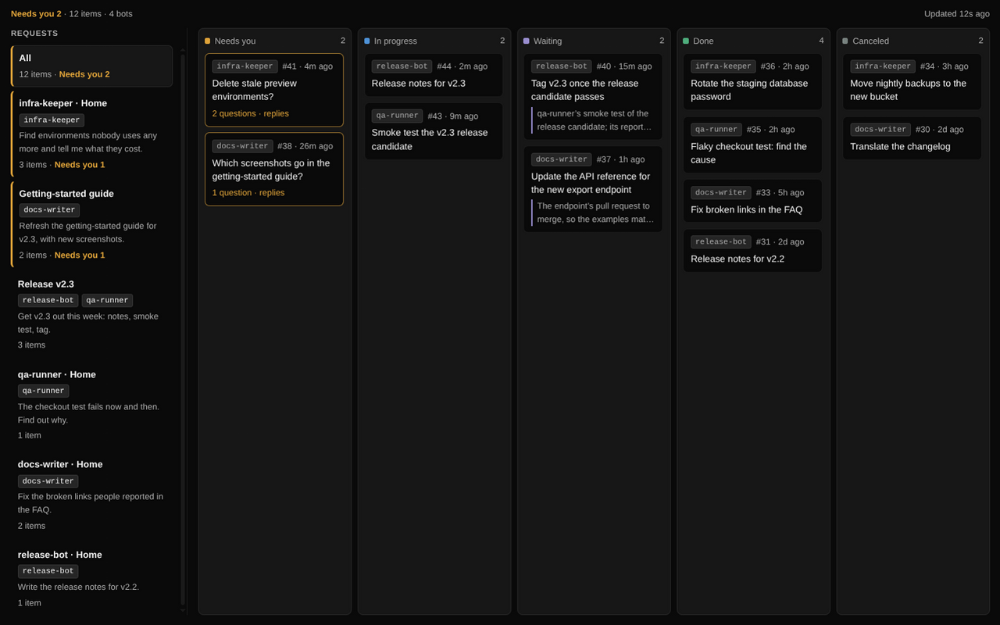
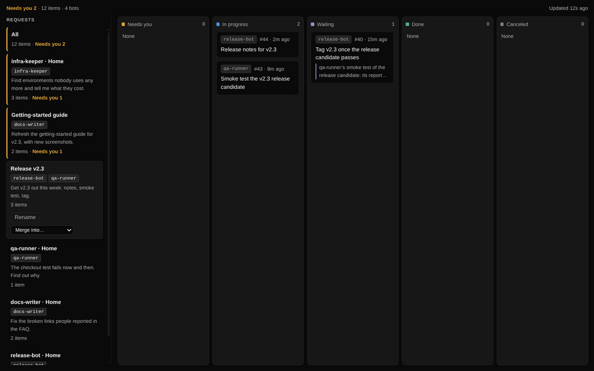
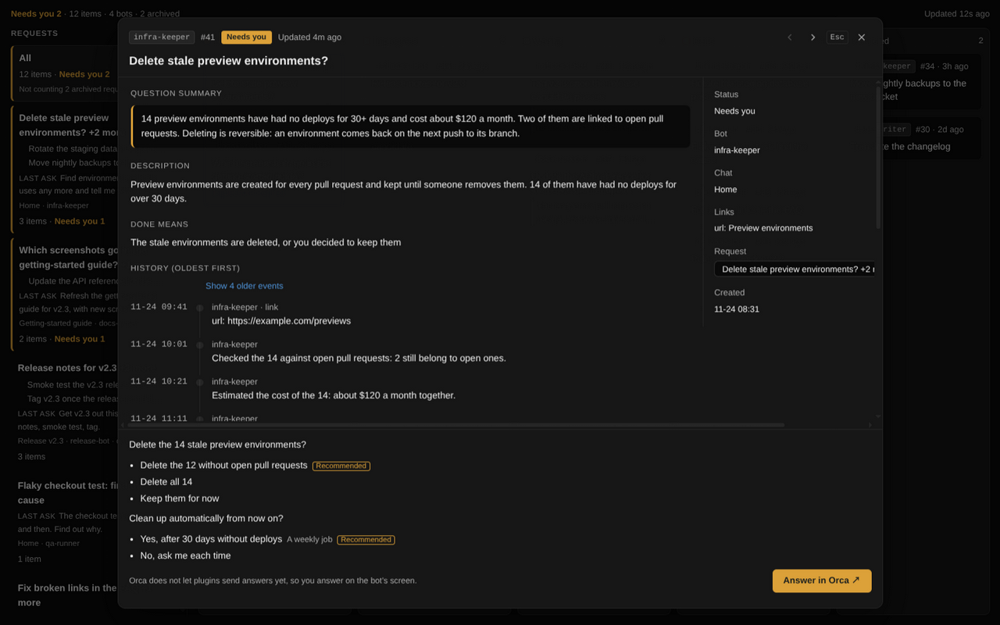
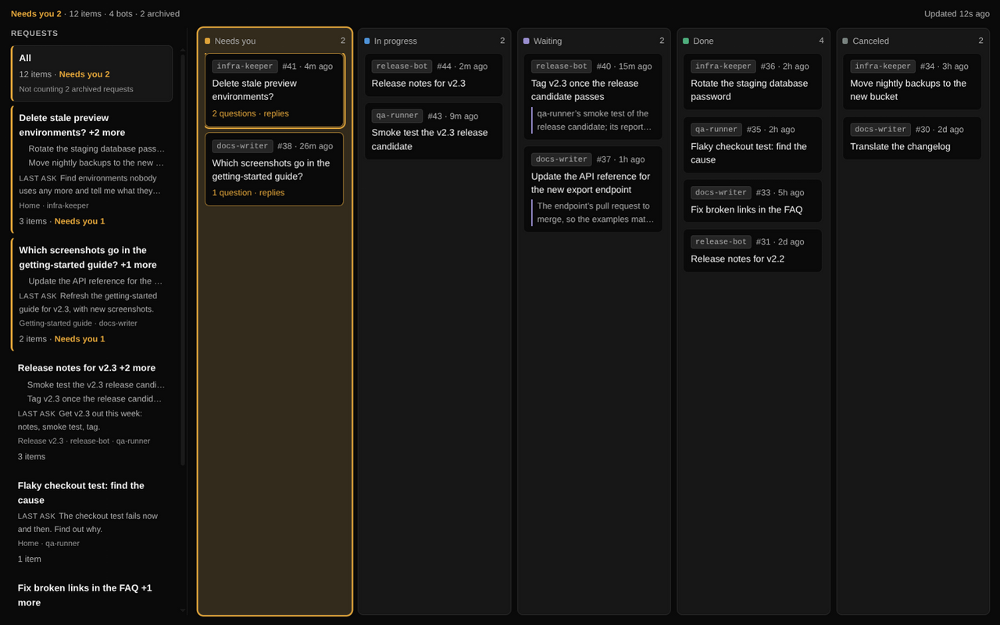

# Bot Items Board

An [Orca](https://orca.dev) plugin that puts every bot's Items on this computer on one wide board,
by status, and keeps what you need to answer a **Needs you** Item one click away: the question's
summary, the Item's history, and the bot's suggested replies.

The interface is in **English and Japanese**. It follows Orca's display language: Japanese when
Orca is in Japanese, English otherwise. The status bar's tooltip is English until the board or the
panel has been opened once, since only they can see Orca's language.







## What it does

- **Requests (left list).** Every chat makes a request on its own; a group room's chats make one
  request with every bot in the room. **All** comes first.
  - A request is named after its oldest Item (the one it started with), with "+N more" when
    others followed; the newer Items' titles are listed under it. A request of one Item shows the
    first line of its description instead. A name you give it wins.
  - Each row also shows how many Items it holds and how many need you. Rows with Needs you stand
    out and come first.
  - In small print: the chat's own name (Home, a room's title) and the bots, and the chat's
    **last ask** only when it reads like your own words. Orca's "last asked" is the chat's last
    incoming message, often mail from Orca or another bot. Those, and anything with ids, are
    never shown. No UUID or session id appears anywhere on the board.
  - Choose a row to narrow the board's columns to that request's Items. The choice is saved.
  - **Archived.** A request whose Items are all closed (Done or Canceled), the last one closed at
    least **Archive requests after (days)** ago (7 by default; 0 never archives), moves into a
    collapsed **Archived (n)** section at the bottom of the list. Nothing is saved for this: a new
    or reopened Item brings the request straight back. **All** doesn't count archived requests
    (its row says how many it leaves out) and leaves their Items off the board; choose an
    archived request to see them.
  - Fix them by hand: **Rename**; **Merge into…** another request; split by moving an Item to
    another request, or to a **New request**, from the **Request** menu in its box; **Undo edits**
    puts a request back. Edits are saved and replayed on every refresh.

- **Board (main area).** The columns are Needs you, In progress, Waiting, Planned (when there are
  any), Done and Canceled. Each column scrolls on its own. Done and Canceled show their newest 20
  Items and keep the rest behind "+N".
- **Cards.** Each card shows the bot, the Item number, when it last changed and the title. A
  Waiting card also shows what it waits on, and a Needs you card shows how many questions it asks.
- **Floating box.** Click a card (or press Enter on it) to open the box over a dimmed board. It shows:
  - the question summary (Needs you only), then the description and done-means;
  - the history, oldest first: the newest 10 events, with "show more" for the rest;
  - an info column with the status, bot, chat, links (PRs, workers, URLs) and dates;
  - for Needs you, each question with its replies; the recommended one is marked, and an
    **Answer in Orca ↗** button.
- **Keys in the box.**
  - Esc, × or a click outside closes it and puts focus back on the card.
  - ← and → move to the previous or next Item in the same column.
  - Tab cycles inside the box. Only the body scrolls; the header and the answer area stay put.
- **Sidebar panel.** Counts (Needs you first), the Needs you list, and two buttons: **Open board**
  and **Show Needs you**, which does what the status bar does.
- **Status bar.** `Needs you n` stays current. Pressing it opens the board and shows what needs
  you, without opening any box:
  - the request list goes back to **All**, even if another or an archived request was chosen;
  - the Needs you column glows for a moment and scrolls into view;
  - the first Needs you card gets the focus, so Enter opens it.

  
- **Commands.**
  - `Items: Open Board` opens the board.
  - `Items: Show Needs You` does what the status bar does.
  - `Items: Answer Next Needs You` opens the box of the Needs you Item that has waited longest.
- **First run.** The board opens once by itself the first time the plugin runs after you enable
  it. The **Open the board on first run** setting turns itself off afterwards; turn it back on to
  repeat it.

The board refreshes every 30 seconds while it is open (Orca sends plugins no Item events), and
right away when another open board or panel notices a change.

## Answering: a known limitation

Orca does not yet let a plugin answer an Item as its owner, so the box can't send your reply.
Until it can:

- The questions and their replies are shown as a list to read. The recommended reply has a badge.
- **Answer in Orca ↗** is the one button. It brings the bot's screen (its Home) to the front and
  closes the box. A note on the board then tells you where to answer: in the panel on the right,
  under Needs you, open the Item.
- Behind the scenes, the plugin shows the folder workspace of the Item's chat. If that can't be
  found, it hands `orca://bot/<id>` to the OS instead.

Why the box can't answer, as of Orca 1.4.272:

- Owner answers go through Orca's `bots.items.owner.comment` call, which refuses the `orca` CLI.
- `orca bot item comment` writes only from a bot's own chat.
- The plugin host API has no Item methods or events.

The answer-in-place UI (reply buttons, free text, Send, number keys and ⌘/Ctrl+Enter) is kept in
the code behind a flag, ready for when Orca adds the API. See
[docs/answer-in-place.md](docs/answer-in-place.md). Feature request:
[stablyai/orca#48010](https://github.com/stablyai/orca/issues/48010).

## Install

- In Orca: **Settings → Plugins**, search for *Bot Items Board*, then install and approve it.
- Or from a terminal: `orca plugin install penguinwokrs/orca-items-board`

The board opens once by itself. Later, open it with the status bar's `Needs you n`, the panel's
**Open board** button, or the command palette.

## Access it asks for

| Access | Why |
| --- | --- |
| `trusted-worker` (runs its own Node process) | The worker reads Items with the `orca` CLI: `orca bot list`, `orca bot item list`, `orca bot item show`, `orca bot chats` (chat names and last asks for the request list) and `orca agent list` (which workspace holds a bot's chat). It never writes to Items. To keep the board file, it creates its own folder in your app data folder and registers it once as a folder project (`orca repo list`, `orca repo add --kind folder`, `orca worktree list`). As a fallback for **Answer in Orca ↗**, it hands `orca://bot/<id>` to the OS URL handler. |
| `workspace:write` | Shows things in Orca: `workspace.open` and `editor.open` for the board file's tab, `workspace.open` for a bot's Home, and `project.setHidden` to keep the board's folder project out of the sidebar. |
| `settings:own` | Its own settings: the `orca` path, the refresh interval, the board folder, whether that folder is hidden, the archive days and the first-run flag (turned off after the first open). |
| `storage:own` | Your request edits (renames, splits, merges) and the request you chose, saved in the plugin's own storage. New in 0.2.0: approving the update grants it. |

It makes no network requests and collects no data.

## Where the board file lives

Orca opens files only inside a workspace, so the board is a small `.itemsboard` file in a folder of
the plugin's own:

| OS | Folder |
| --- | --- |
| Linux | `${XDG_DATA_HOME:-~/.local/share}/orca-items-board` |
| macOS | `~/Library/Application Support/orca-items-board` |
| Windows | `%LOCALAPPDATA%\orca-items-board` (`<home>\AppData\Local\orca-items-board` when the variable is missing) |

- The folder holds only `Bot Items.itemsboard`.
- The plugin registers the folder once as a folder project on the computer Orca runs on, never
  on an SSH or WSL host. An existing registration is reused. Paths are compared as real paths,
  ignoring case on Windows and macOS.
- The project is hidden from Orca's sidebar. The board still opens; turn this off in Settings.
- Opening the board switches Orca to that folder workspace.
- **Board folder** (Settings) moves it elsewhere.
- Versions before 0.2.0 kept the file in a Git checkout's `.git/orca-items-board/`. The plugin
  removes those files when it starts, but only ones whose text is exactly what it wrote.

You can also create a board in the current workspace from the tab bar's **+** menu
(*Bot Items Board*).

## Demo mode

Open a `.itemsboard` file whose text is `{"source":"demo"}`. The board then draws made-up bots and
Items, and never reads your own. This is how the screenshots were made. Options:

- `"open": 41` opens that Item's box.
- `"scroll": "end"` scrolls the box to the end of its history.
- `"press": "answer"` presses **Answer in Orca ↗** (the demo pretends the bot opened);
  `"press": "needsYou"` does what the status bar does.
- `"answerInPlace": true` previews the answer-in-place UI.
- `"locale": "en"` or `"ja"` draws it in that language instead of Orca's.
- `"request": "g:Release v2.3"` selects a request; `"edits": {…}` starts from saved-style
  request edits (nothing is saved in demo mode); `"show": "rename"` or `"move"` opens that tool.

See [`examples/`](examples).

## Saved data

Request edits and the chosen request are kept in the plugin's storage (`storage:own`). One value
holds up to 256 KiB, and edits are compact: an Item move takes about 4 bytes. The board warns past
200,000 bytes. A save Orca refuses, or an edit that would pass the limit, shows on the board with
what to do. Versions that kept them in Settings are moved over on the first load, and the settings
are cleared.

## Platforms

Built and tested on Linux. **Windows and macOS have not been tried on a real machine yet**; the
platform code paths are covered by unit tests with the platform swapped in:

- Windows: `orca.cmd` is not run through a shell. The plugin reads the launcher it names
  (`orca.exe`) and runs that directly. APPDATA and LOCALAPPDATA are filled in when the worker
  lacks them. URLs open with `rundll32 url.dll,FileProtocolHandler`.
- macOS: URLs open with `open`, and the board folder is in Application Support.

## Settings

| Setting | Default | |
| --- | --- | --- |
| orca CLI path | empty | The `orca` executable. Empty: looked up on `PATH` (on Windows `orca.exe`, then `orca.cmd`), then in Orca's Linux CLI folder. |
| Refresh every (seconds) | 30 | How often an open board, panel or the status bar re-reads Items. |
| Board folder | empty | Where the board file lives. Empty: the app data folder above. |
| Hide the board folder in the sidebar | on | Keeps the board's folder project out of Orca's sidebar. |
| Open the board on first run | on | Opens the board once, the next time the plugin starts, then turns itself off. |
| Archive requests after (days) | 7 | Days after a request's last Item closes before it moves under Archived. 0 never archives. |

## Development

```sh
npm install                 # typescript, @types/node, happy-dom: type checks and tests only
orca plugin types .         # writes .orca/types (git-ignored)
npx tsc -p .
orca plugin test . --json
orca plugin check . --json
orca plugin dev load . --json
orca plugin shot . --editor examples/demo.itemsboard --width 1280 --height 800 --out images/board.png --json
```

The layout:

- `src/board.ts` reads and normalises the CLI output.
- `src/worker.ts` holds the worker's handlers, commands and status bar.
- `editor/view.ts` draws the board and the box; its tests run in happy-dom.
- `src/panel.tsx` is the sidebar panel.
- `src/i18n.ts` holds the English and Japanese words.
- `src/requests.ts` builds the request list and applies the owner's edits.

## Design decisions

The decisions behind the board are recorded as ADRs in [docs/adr](docs/adr/README.md).

## License

[MIT](LICENSE)
