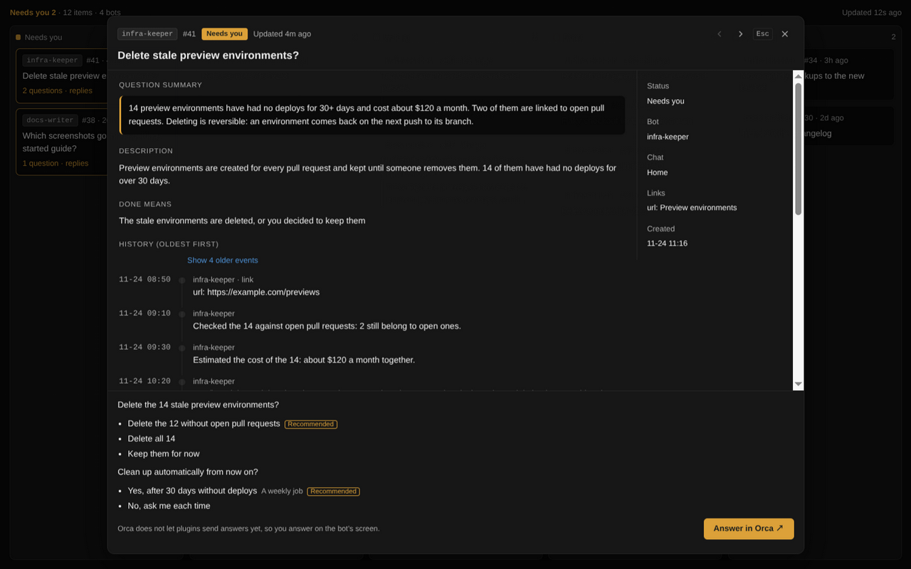
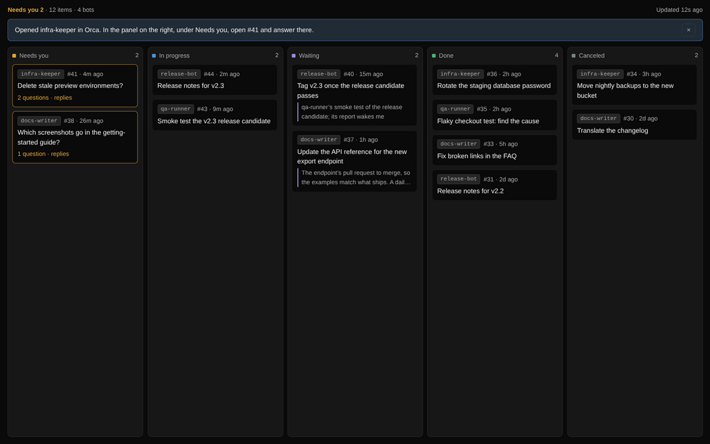
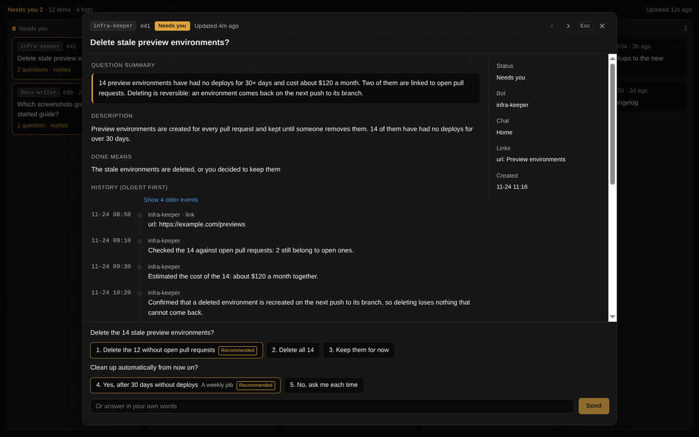

# Answering in place

The board was designed so the owner answers a **Needs you** Item without leaving the floating box:
pick a reply per question, or write a few words, and send. Orca 1.4.272 gives plugins no way to
answer an Item as its owner, so v0.1.0 ships a stand-in: the box lists the replies to read and
offers one button, **Answer in Orca ↗**, which brings the bot's screen to the front.

The answer-in-place UI is still in the code, behind a flag, so it can come back once Orca adds the
API ([stablyai/orca#48010](https://github.com/stablyai/orca/issues/48010)). This page records how
it works and what turning it back on takes.

## What ships now (v0.1.0)



- Each question is followed by its replies as a bulleted list. The recommended reply carries a
  **Recommended** badge. Nothing in the list is pressable.
- There is no free-text box.
- The only button is **Answer in Orca ↗**. Pressing it:
  1. asks the worker for `bot.open`. The worker finds the folder workspace of the Item's chat in
     `orca agent list --json` (a bot's Home is a folder workspace) and shows it with
     `workspace.open`.
  2. If no folder workspace is found or `workspace.open` fails, it falls back to `orca://bot/<id>`
     through the OS URL handler.
  3. closes the box, and puts a notice at the top of the board saying where to answer.



Why not only the deep link: in one test on 1.4.272, `orca://bot/<id>` opened the bot's Home. In
another, with this board's file tab in front, it changed nothing visible. `workspace.open` on the bot's folder workspace switched to its Home,
with the Item listed under Needs you in the right-hand panel. Orca's deep link names an Item only
for conversations from outside services, so neither path can open the Item itself.

## The answer-in-place UI (behind the flag)



As in the original design, the answer area is pinned to the bottom of the box (Needs you only):

| Part | Behaviour |
| --- | --- |
| Reply buttons | One row per question, numbered across the box: 1, 2, 3… The recommended one has a **Recommended** tag. A press toggles it (`aria-pressed`). A single-choice question keeps one reply; a `multi` question keeps several. |
| Free text | "Or answer in your own words", kept as a draft per Item while the board is open. |
| Send | Enabled once any reply is picked or text is written. On success the area says it was sent, and the Item moves to In progress on the next refresh. |

Keys inside the box:

| Key | Action |
| --- | --- |
| `1`–`9` | Toggle that numbered reply (not while typing in the text box). |
| `⌘`/`Ctrl` + `Enter` | Send, also from the text box. |
| `Esc`, `←` `→`, `Tab` | As everywhere in the box: close, previous or next Item in the column, and cycle focus inside the box. |

The flag lives in `editor/view.ts`:

```ts
const answerInPlace = (): boolean =>
  !!deps.answer && (snapshot?.answer.available === true || deps.answerPreview === true)
```

- `deps.answer` is how the box sends. The live editor (`editor/board.ts`) doesn't pass it yet.
- `snapshot.answer.available` comes from the worker. `loadBoard` sets it to `false` with the
  reason `ANSWER_UNAVAILABLE`.
- `answerPreview` draws the UI anyway, for demos and docs. Demo files take
  `{"source":"demo","open":41,"answerInPlace":true}`.

The tests in `editor/view.test.ts` cover the reply buttons, digits, the free text, `⌘Enter` and
the payload, so the UI keeps working while it is off.

## Data kept for answering

The worker already normalises everything an answer needs (`src/protocol.ts`):

| Field | Where | Use |
| --- | --- | --- |
| `question.eventId` | `BoardItem.question` | The event that asked: Orca's `questionId`, so an answer to a question the bot has since replaced is refused. |
| `decisions[].index`, `replies[].index` | `Decision`, `QuickReply` | Which reply of which question was picked; also how unanswered questions would be named (`skipped`). |
| `decisions[].multi` | `Decision` | Whether a question takes several replies. |
| `replies[].label`, `recommended`, `detail` | `QuickReply` | What the answer says, and what the UI marks. |
| `lastEventId`, `othersLastEventId` | `BoardItem` | Detecting that the Item changed since it was read. |
| `answers` | `ItemEvent` | An owner comment's link to the question it answered, shown in the history. |
| `AnswerInput` | `src/protocol.ts` | What the box sends: `{ number, questionId, picks: [{ decision, replies }], text }`. |

## What Orca needs to add

Orca's own UI answers through the runtime call `bots.items.owner.comment`
(`src/main/runtime/rpc/methods/bots-items-owner-methods.ts`). It takes these parameters:

- `item`, `text`, `images`;
- `requestId`, to make the call idempotent;
- `questionId`;
- `plain`, for a comment that answers nothing;
- `skills`;
- `skipped`, the question lines left unanswered.

It records the comment with the owner as its author, then mails the Item's chat so the bot wakes
up. That call refuses the `orca` CLI on purpose (`ownerOnly`). `orca bot item comment` writes only
from a bot's own chat.

The plugin needs one of these, behind a capability the person approves (for example `bots:items`):

- a host API method, for example `botItems.ownerComment({ item, text, questionId, requestId, skipped })`;
- or a CLI command that answers as the owner when run outside a bot's chat.

Read methods and Item events (`botItems.list`, `botItems.show`, `bot.item.changed`) would also
replace the CLI polling. The full request is
[stablyai/orca#48010](https://github.com/stablyai/orca/issues/48010).

## Turning it back on

1. **Worker (`src/worker.ts`).** Add a handler `item.answer` that takes `AnswerInput`:
   1. resolve the picked replies to their labels;
   2. join them with the free text into the comment;
   3. pass `questionId`, a fresh `requestId` and the unpicked questions as `skipped` to the new host
      API;
   4. declare the new capability in `orca-plugin.json`.
2. **Availability (`src/board.ts`).** Report `answer: { available: true }` when the host has the
   method (`orca.host.has('<method>')`). Keep `false` and the reason otherwise, so older Orca keeps
   the stand-in.
3. **Editor (`editor/board.ts`).** Pass
   `answer: (item, input) => orca.plugin.request('item.answer', input)` to `mountBoardView`.
4. **Keep the stand-in as a fallback.** With the flag off, the box still shows
   **Answer in Orca ↗**.
5. **Tests.** Add a worker test for `item.answer` (labels, `skipped`, `questionId`). The view tests
   need no change.
6. **Copy.** Update the README's "known limitation" section, and the screenshots
   (`examples/demo-answer-in-place.itemsboard` shows the UI).
